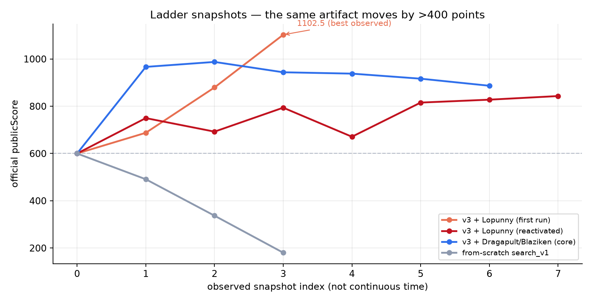
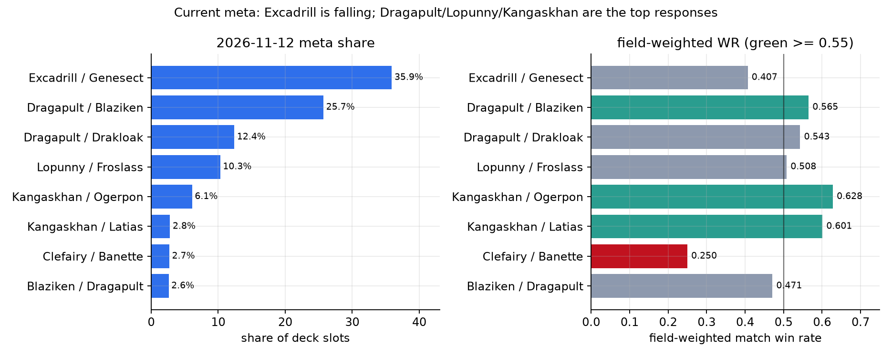
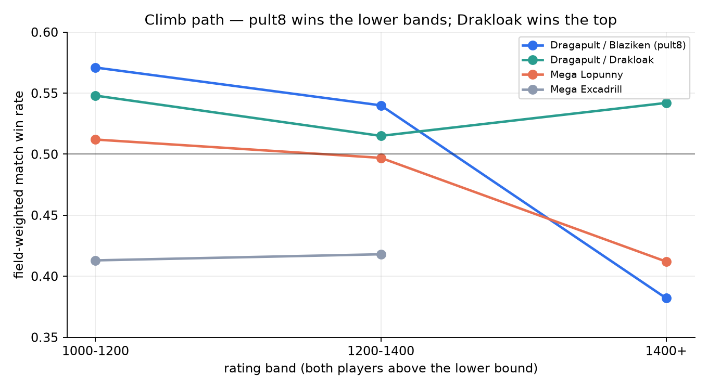
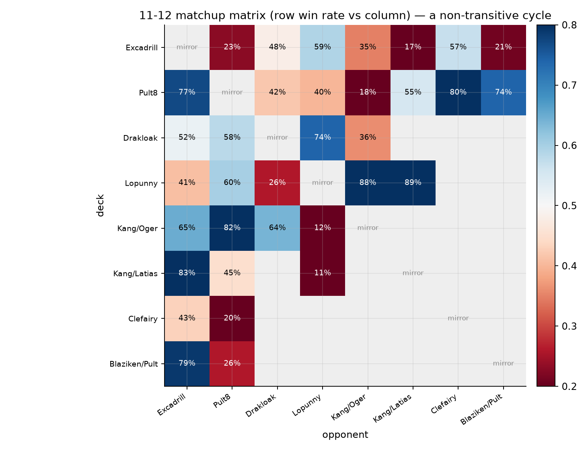
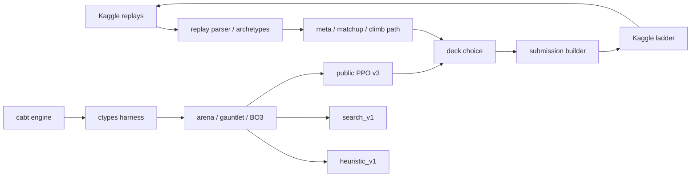

# PTCG AI Battle Lab


An experimental Pokémon TCG battle agent for the Kaggle **PTCG AI Battle
Challenge Playground** (cabt engine v2): a legality-safe rule engine, a
determinized forward-search overlay, a fast ctypes battle harness, a
seat-swapped arena with confidence intervals, replay mining from 1,694 real
ladder games, and a reproducible submission builder.

> **Status: research project complete (2026-11-13).** Real submissions were
> made; the ladder is noisy (±100+ points for the same artifact), so the
> reported scores are observations, not claims of stable strength. The engine is
> non-deterministic (no seed control); local results are win rates with Wilson
> 95% CIs.

## Highlights

- **Fast local lab:** ctypes battle loop at ~10 ms/game; seat-swapped arena with Wilson CIs; meta-weighted gauntlet and BO3 arena.
- **Recovered native search API:** `AgentStart`/`SearchBegin`/`SearchStep` bound with ctypes; the official SDK later confirmed the exact signature.
- **Real replay mining:** 1,694 (11-09) + 1,625 (11-12) ladder matches; archetypes, matchup matrices, climb path, 65.2% pilot agreement.
- **Real ladder:** best observed **1102.5**; stable core **886.7**; from-scratch `search_v1` **180.3**.
- **Negative results kept:** linear BC, search overlay, hand-written reranker, BC fine-tune — all measured and documented.

## Best result — official ladder (dynamic)

| What | Result |
|---|---|
| **Best observed publicScore** | **1102.5** — public PPO v3 + Mega Lopunny #05 (submission 58273092; a high-variance run, now inactive) |
| **Stable core (last observed)** | **886.7** — public PPO v3 + Dragapult/Blaziken #08 (submission 58273532; rank ~237/712) |
| **From-scratch best** | **180.3** — `search_v1` + Dragapult (submission 58273236) |
| **Local head-to-head** | public v3 beats our `heuristic_v1` **90%** and our `search_v1` **100%**; `search_v1` beats `heuristic_v1` **61.3%** on Lopunny (600 games) |

> The ladder is not an instrument: the same Lopunny artifact produced 1102.5,
> 843.1, 815.5, 671.0... across runs. **1102.5 is a hot streak, not a stable
> strength estimate**; 886.7 is the last observation of the stable core.
> See `docs/LADDER.md`.



## Design philosophy

1. **Research before building.** Read the rules, engine API and public field first; the public PPO baseline was 90–100% stronger than our from-scratch agents, so reusing it was the highest-value decision.
2. **Reuse mature components, keep the code small.** The public v3 checkpoint is MIT and credited; our work is the harness, evaluation, meta analysis, deck choice and the experiments around it.
3. **Legality by construction.** Every return is clamped to the offered options and `[minCount, maxCount]`; a crash, illegal index or timeout is an instant loss. All measured agents had 0 illegal / 0 exceptions.
4. **Measure like a scientist.** Seat-swapped batches, Wilson 95% CIs, fixed decks for policy A/Bs, fixed pilots for deck A/Bs. Overlapping CIs mean "no measured difference".
5. **The ladder is noisy; the local arena is the instrument.** Same-artifact variance is ±100+ points; decisions use local arenas plus 1,694/1,625-game replay matrices, the ladder only as a final noisy judge.
6. **Separate deck and pilot, then evaluate the joint.** A deck can be the paper best response and still be unplayable by your pilot (Kangaskhan/Latias: 59% under its owner, 43.8% under v3 with stalls).
7. **Climb path beats equilibrium.** A top-band specialist that cannot survive the lower bands never reaches its band. pult8 is the best climber (0.571 at 1000–1200, 0.540 at 1200–1400); Drakloak is a top-band specialist but weak at 1000–1200.
8. **Keep negative results.** Greedy < random on the beginner deck; BC offline 46.4% but 40% online; search overlay 48%; fine-tune offline +11.6 but online 51.5%/37.0%. Offline agreement is not win rate.
9. **Respect the data license.** The engine/card data is competition-use-only and is not redistributed; public replays are CC0; the public PPO code/weights are MIT. See `THIRD_PARTY_NOTICES.md`.

## What the data showed







The meta is **non-transitive**: Excadrill beats Lopunny, Lopunny beats
Kangaskhan, Kangaskhan beats Excadrill. The paper best response (Kangaskhan /
Ogerpon, field-WR 0.628) was **not executable by the public v3 pilot** (29.1% in
its own round-robin), so the practical core is the best *climber*: pult8 wins the
1000–1400 bands, while Drakloak is the top-band specialist. See
`docs/METAGAME.md`.

## Project status

Complete (2026-11-13). Full narrative: **`FINAL_REPORT.md`** · experiments: **`EXPERIMENTS.md`** · research: **`RESEARCH.md`** · docs index: **`docs/INDEX.md`**.

## Architecture



Everything is evaluated twice: local seat-swapped games (fast, controlled) and
the official ladder (slow, noisy). The ladder feeds the next day's replay
analysis; deck choice is a function of the current meta, not a permanent answer.

## Agents

### Strongest local agent — public PPO v3 + Dragapult/Blaziken (core), Lopunny hedge

Community mining found that the public field is dominated by one PPO
token-transformer family (Dipam Chakraborty, MIT; new-card port and BO3 fixes by
public notebooks). Its packaged output scored **1074.1** on the public ladder.

We benchmarked it and re-decked the same model to the current meta:

| Matchup | Games | Win rate |
|---|---:|---:|
| public v3 (Alakazam) vs our `heuristic_v1` | 40 | **90.0%** |
| public v3 (Alakazam) vs our `search_v1` | 40 | **100%** |
| v3 + Lopunny vs v3 + Alakazam | 160 | **81.9%** |
| v3 + Lopunny vs v3 + Dragapult / Excadrill | 160 each | 48.1% / 49.4% |

The 2026-11-12 meta is Excadrill 35.9%, Dragapult/Blaziken 25.7%, Lopunny
10.3%. **Dragapult/Blaziken #08 is the stable core** (best climber: field-WR
0.571 at 1000–1200, 0.540 at 1200–1400). **Lopunny is the high-variance hedge**
(best observed 1102.5, last observed 843.1). Both were submitted; see
`docs/PUBLIC_BASELINE.md` and `docs/LADDER.md`.

### From-scratch agent — `search_v1` + Dragapult

Built entirely in this repo: a card-DB-aware rule engine, then a determinized
forward-search overlay using the engine's native search API.

- Rule engine `heuristic_v1` (legality by construction) as base policy,
  candidate generator and rollout policy.
- 1-ply determinized search on MAIN: top-4 candidates, 2 rollouts × 8 steps,
  confidence gate (override only on a ≥200-point margin).
- 0 illegal actions / 0 exceptions; p95 40 ms per decision; ~16 s per BO3.

| Arm | Result |
|---|---|
| h1 vs random / first / greedy | 95.0% / 99.0% / 96.0% |
| search vs h1 (Lopunny, 600 games) | **61.3%** (57.4–65.2%) |
| search vs h1 (Dragapult, 600 games) | **54.2%** (50.2–58.2%) |
| final vs pre-iteration agent (200 games) | **90.0%** (85.1–93.4%) |
| imitation baseline (BC) vs h1 | 40.0% — negative result |
| fine-tune v3 (BC on 11-12) | offline +11.6 pts, online 51.5% / Lopunny 37.0% — negative |

Details, ablations and caveats: `EXPERIMENTS.md`.

## What is here

| Path | Purpose |
|---|---|
| `agents/heuristic_v1/` | rule-based policy (base) |
| `agents/search_v1/` | final agent: search overlay + Dragapult deck |
| `agents/bc_linear/` | imitation arm (negative result, kept for the record) |
| `agents/{random,first,greedy}_legal/` | floor baselines |
| `decks/meta/` | top exact lists mined from real replays |
| `src/ptcg_ai/` | card DB, deck validation, obs helpers, harness, replay parser |
| `scripts/` | arena, gauntlet, meta analysis, replay mining, divergence, BC, submission builder |
| `vendor/cg/` | official `cg` SDK (not included; copy from competition Data — see `vendor/README.md`) |
| `docs/` | engineering notes, deck tournament, BC report, search API, public baseline |
| `RESEARCH.md` | competition/engine/prior-art research and route decisions |
| `EXPERIMENTS.md` | protocol, all measured results, threats to validity |
| `FINAL_REPORT.md` | final progress summary, negative results, distribution notes |

## Install

```bash
python3 -m venv .venv
.venv/bin/pip install -r requirements.txt
.venv/bin/python scripts/prepare_agents.py   # card DB + agent card_meta.json (git-ignored)
```

`kaggle-environments==1.33.3` ships the compiled `cabt` engine. The card
database is licensed competition data and is **not** committed (`data/` and
`agents/*/card_meta.json` are git-ignored); `prepare_agents.py` regenerates both
from the installed engine.

The search arm also needs the official `cg` SDK at `vendor/cg/`. It is **not**
included because the engine is competition-use-only; copy it from the
competition Data page (see `vendor/README.md`).

## Run a game / a batch

```bash
# 200 games, alternating seats, 3 worker processes
.venv/bin/python scripts/arena.py \
  --agent-a agents/heuristic_v1 --deck-a decks/meta/03_Dragapult_ex.csv \
  --agent-b agents/greedy       --deck-b decks/meta/03_Dragapult_ex.csv \
  --games 200 --workers 3 --name-a heuristic_v1 --name-b greedy \
  --out results/policy_v1_vs_greedy.jsonl
```

The search agent imports the SDK shim locally:

```bash
PYTHONPATH=vendor .venv/bin/python scripts/arena.py \
  --agent-a agents/search_v1 --deck-a decks/meta/03_Dragapult_ex.csv \
  --agent-b agents/heuristic_v1 --deck-b decks/meta/03_Dragapult_ex.csv \
  --games 200 --workers 3
```

Output: a JSON summary with win rate, Wilson CI, illegal/error counts, turns and
decision latency, plus one JSON line per game.

## Validate a deck

```bash
.venv/bin/python scripts/validate_deck.py decks/meta/*.csv
```

## Build and verify a submission

Primary candidate (public PPO v3, MIT, re-decked to Lopunny):

```bash
.venv/bin/python scripts/fetch_public_v3.py \
  --deck decks/meta/05_Mega_Lopunny_ex.csv \
  --out data/public_v3 \
  --pack submissions/public_v3_lop.tar.gz
PYTHONPATH=vendor .venv/bin/python scripts/kaggle_smoke.py \
  submissions/public_v3_lop.tar.gz --games 3 --opponent agents/greedy
```

From-scratch agent:

```bash
.venv/bin/python scripts/build_submission.py --agent agents/search_v1 \
  --out submissions/search_v1_pult.tar.gz --verify 10
```

The primary tarball is ready; uploading requires accepting the competition
rules on the Kaggle website (the API returns `403 ... accept its rules first`).

The tarball has `main.py` at the top level, `deck.csv`, `base_policy.py`,
`card_meta.json` and `meta/*.csv`. `kaggle_smoke.py` runs it in the real
`make("cabt")` environment (BO1). The agent falls back to the heuristic if
`cg.api` is unavailable, so a missing SDK cannot crash the submission.

## Mine real replays

Kaggle publishes daily replay datasets for the playground. Download one with
`kagglehub` (public, no credentials needed) and analyse it:

```bash
.venv/bin/python - <<'PY'
import kagglehub
print(kagglehub.dataset_download("kaggle/the-pokemon-company-ptcg-ai-battle-challenge-playground-episodes-2026-11-09"))
PY

.venv/bin/python scripts/analyze_episodes.py <episodes_dir> --out results/meta_1109
.venv/bin/python scripts/mine_decisions.py  <episodes_dir> --limit 100
.venv/bin/python scripts/divergence.py      <episodes_dir> --agent agents/heuristic_v1
```

## Test

```bash
.venv/bin/pytest -q
```

## How it works in one paragraph

The engine is a process-global ctypes singleton. A battle is a loop of
`obs["select"]` prompts; the agent returns indices into the offered options (or
the 60 card ids when `select` is None). An illegal index, an exception or a
timeout loses the game, so every policy is legal by construction. MAIN is a
sequential menu and attacking ends the turn — the single most important
piloting rule, mined from real replays and encoded as "develop first, attack
last, unless lethal". The from-scratch agent adds determinized forward search on
top, with a confidence gate so search only overrides the heuristic when it is
clearly better. After the public-baseline measurement showed a ~90–100% gap, the
project pivoted: the mature public PPO model is the submission base, and our
experiments now target its deck, turn order and search configuration.

## Distribution & licenses

- **Code:** MIT (`LICENSE`).
- **Not included:** the `ptcgProgram` engine, card database, official `cg` SDK,
  raw replay files, and the public PPO checkpoint. The engine is
  competition-use-only: no redistribution, delete copies after the competition.
- **Replay data:** the Kaggle daily episodes and Darren Sheehan's parsed ladder
  dataset are CC0; only derived statistics are committed.
- **Public PPO v3:** Dipam Chakraborty's code/weights are MIT;
  `scripts/fetch_public_v3.py` downloads the public notebook output at runtime.
- See `THIRD_PARTY_NOTICES.md` for attribution and `vendor/README.md` for the
  SDK terms.
